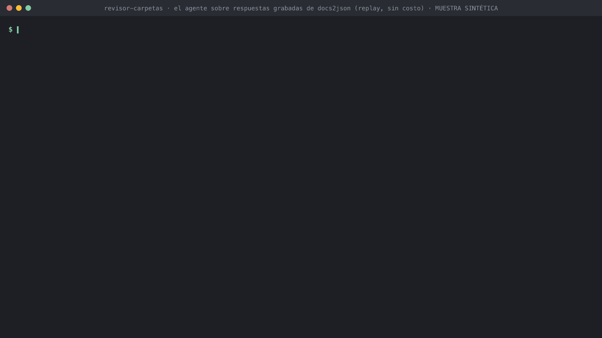
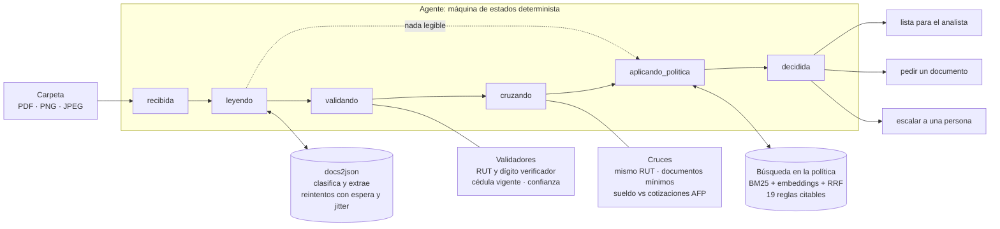

# revisor-carpetas

Un agente que hace la primera revisión de la carpeta de documentos de una persona que pide un crédito en Chile: cédula, liquidaciones de sueldo, certificado de cotizaciones de la AFP y certificado de antigüedad.

**El problema.** Antes de evaluar un crédito, alguien tiene que comprobar que la carpeta está completa, que todos los documentos son de la misma persona, que la cédula está vigente y que el sueldo declarado coincide con lo que se cotizó. Es trabajo repetitivo, pero exige criterio: una liquidación con otro RUT puede ser un error del empleador o una adulteración.

**Lo que hace el agente.** Lee cada documento con la API de docs2json ([demo pública](https://demo.docs2json.cl)), valida cada uno, los cruza entre sí y busca en una política escrita la regla que aplica. Después decide: **lista para el analista**, **pedir un documento** o **escalar a una persona**. Cada decisión trae los motivos, la evidencia (archivo, campo y valor) y la regla citada.

> **Solo datos sintéticos.** Personas, empresas, AFP, isapres, documentos y política son inventados, y cada documento dice «MUESTRA SINTÉTICA». Los RUT tienen 9 dígitos, algo que ningún RUT real tiene. Las cifras miden el sistema sobre ese dataset; no son precisión en producción.



*El agente sobre tres carpetas, en modo replay con respuestas grabadas de docs2json: una sana, una con RUT distinto y una con un sueldo que no cuadra con las cotizaciones. Video en [docs/demo.mp4](docs/demo.mp4).*

## Arquitectura



- **El flujo es código determinista y la IA está en las herramientas.** El modelo de lenguaje trabaja donde aporta, leyendo documentos dentro de docs2json. La decisión vive en código y en la política escrita, porque una decisión de crédito tiene que ser repetible y auditable: la misma carpeta da siempre la misma decisión, con los mismos motivos.
- **La política es un documento.** [`politica/politica-evaluacion.md`](politica/politica-evaluacion.md) tiene 19 reglas, cada una con su decisión y sus parámetros escritos en el texto. El agente las busca en local, sin LLM generativo: BM25, embeddings multilingües y una fusión de ambos rankings. Si cambias el documento, cambia el agente.
- **Nada se decide a ciegas.** Si un archivo no se puede leer después de los reintentos, o se lee con baja confianza, la carpeta se escala a una persona con el motivo.

## Probarlo sin clave

Requiere Node 24. Todo esto corre sobre respuestas de docs2json ya grabadas: no llama a la API ni cuesta nada.

```bash
npm ci
npm test                       # 151 tests
npm run demo                   # el agente revisa 4 carpetas y muestra decisión, evidencia y regla
npm run agent -- review f08    # una carpeta, con su recorrido por la máquina de estados
npm run agent -- eval          # eval de punta a punta: decisiones, defectos y falsos positivos
npm run rag:eval               # recall@k y MRR de la búsqueda en la política
npm run dataset                # regenera el dataset sintético
```

Las corridas contra la API real necesitan `DOCS2JSON_API_KEY` en `.env` y cuestan una lectura por archivo: `npm run evals -- --subset limpio --runs 2` (94 llamadas) y `npm run agent -- eval --live` (unas 75).

## Resultados finales

Sobre 18 carpetas sintéticas (12 limpias y 6 difíciles: fotos, escaneos con ruido, páginas giradas, otro formato de liquidación), con cuatro tipos de defecto plantados.

| Qué se midió | Resultado |
|---|---|
| Decisiones correctas del agente, en vivo | **16 de 18**, con **0 errores de decisión**: las 2 erradas se escalaron por lecturas con confianza 0 |
| Defectos plantados encontrados | **12 de 12**, sin defectos inventados |
| Carpetas sanas mandadas a revisión | 1 de 7, por una lectura poco confiable |
| Calidad de extracción cuando la API devuelve datos | 100% en el set limpio · 96,8% en el difícil |
| Fallas silenciosas de la API (HTTP 200 vacío) | **de 9 a 0** después del arreglo en docs2json |
| Búsqueda en la política | las 15 consultas del agente encuentran su regla · recall@3 de 94,1% en 34 preguntas de analista |

Cada cifra con su corrida está en [docs/cifras-finales.md](docs/cifras-finales.md). **Límites:** todo es sintético (el dataset, la política y la decisión esperada de cada carpeta); la muestra es chica, así que sirve para ver qué falla y detectar regresiones, no para una cifra fina; y la disponibilidad de la API depende de la hora.

## Qué encontraron las evals

**Fallas silenciosas: de 9 a 0.** La primera medición de docs2json decía «clasificación 95,8%» y parecía un modelo inestable. Revisando error por error, ninguno era un valor equivocado: eran lecturas que volvían con HTTP 200 y el documento vacío (9 de 121 documentos). La eval pasó a separar dos preguntas: si la API devolvió datos (disponibilidad) y si los datos eran correctos (calidad). El hallazgo llevó a un arreglo en la API: ahora esas fallas responden `503` con un código (`ai_timeout`, `ai_unavailable`). Desde entonces no hubo ninguna falla silenciosa en ninguna corrida, y la disponibilidad con el mismo método pasó de 92,7% a 100%.

**La ventana lenta del proveedor.** Una corrida hecha justo después del arreglo dio 70,8% de disponibilidad. Antes de culpar al arreglo, se comparó la latencia de los mismos documentos: el servicio estaba unas cinco veces más lento esa media hora (mediana de 46,7 s contra 9,3 s), y el modelo no alcanzaba a responder. Repetida más tarde, con el mismo método, dio 100%. La calidad no cambió en ningún momento: cuando la API devolvía datos, eran correctos.

**Por eso el agente reintenta y escala.** Un `503 ai_timeout` llega después de unos 70 s y un `504` del proxy a los 120 s: reintentar cuesta tiempo y una llamada. El agente reintenta solo las fallas transitorias, con espera exponencial y jitter (una espera al azar, para no saturar el servicio), hasta 3 intentos por archivo y 4 reintentos por carpeta. En las dos corridas en vivo hubo 2 y 8 fallas transitorias, y todas se recuperaron con un solo reintento. Si un archivo igual no se puede leer, el agente no decide a ciegas: escala con el motivo «no se pudo leer X» y no acusa un documento faltante que podría estar en ese archivo.

**Otros hallazgos.** El modelo leyó «AFP Cuprum», una AFP real, donde decía «AFP Quillay» (inventada), con confianza 0,99: por eso el agente se apoya en los cruces y en el dígito verificador, más que en la confianza que informa la API. En la búsqueda, dos reglas solo se distinguían por una negación y se confundían; con BM25 sola, eso cambiaba una decisión. Y al pasar los RUT a 9 dígitos para proteger la privacidad, docs2json empezó a devolver confianza 0 en los PDF con dos liquidaciones: un dato imposible cambia al sistema que se prueba. El detalle de todo está en [docs/decisiones.md](docs/decisiones.md).

## Estructura

| Carpeta | Qué hay |
|---|---|
| `src/agent/` | Máquina de estados, herramienta de lectura (en vivo y replay), reintentos, validaciones, política y eval de punta a punta |
| `src/rag/` | Lectura de la política, BM25, embeddings, búsqueda híbrida, índice y eval de búsqueda |
| `src/evals/` | Evals de extracción: normalización, puntaje sin red, consistencia, baseline y comparación |
| `src/dataset/` | Generador del dataset sintético y sus degradaciones (perspectiva, ruido, rotación, JPEG) |
| `src/docs2json/` | Cliente HTTP con tope de llamadas |
| `dataset/`, `politica/`, `evals/` | Las carpetas con su verdad esperada, la política y su índice, y las respuestas grabadas y reportes |
| `docs/` | Decisiones de diseño, cifras finales, diagrama y video |

## Autoría

Proyecto de Luis Vidal (2026), construido con agentes de programación bajo su dirección: definió el problema, aprobó cada fase y revisó las decisiones. docs2json también es suyo (su código es privado) y aquí se usa solo como servicio externo, por HTTP.

## Licencia

MIT. Ver [LICENSE](LICENSE). Los datos del directorio `dataset/` son sintéticos e inventados.
